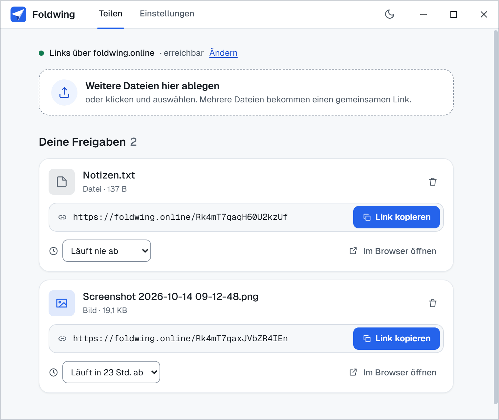
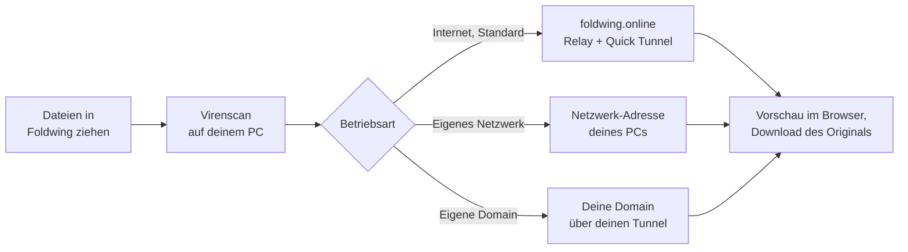
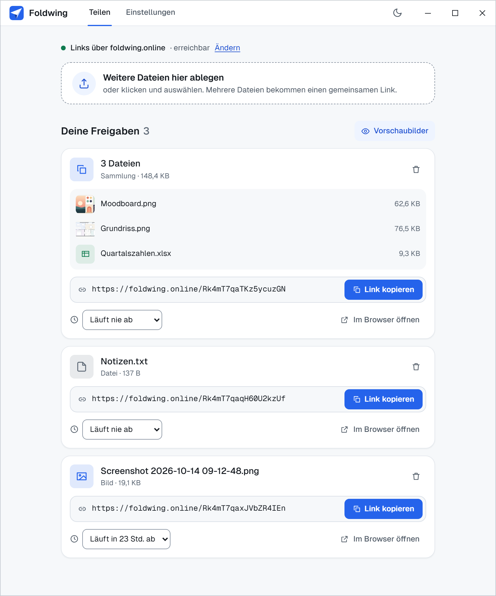
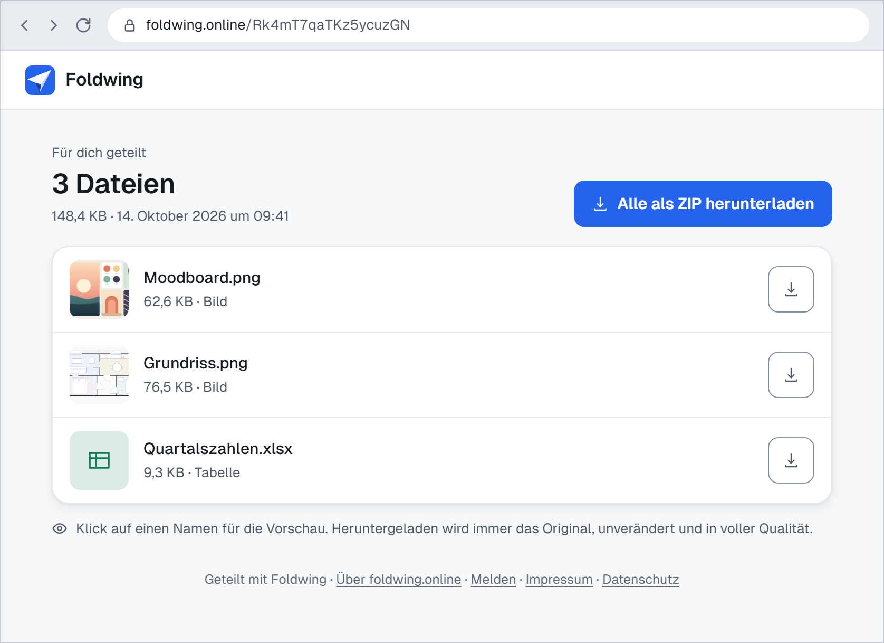
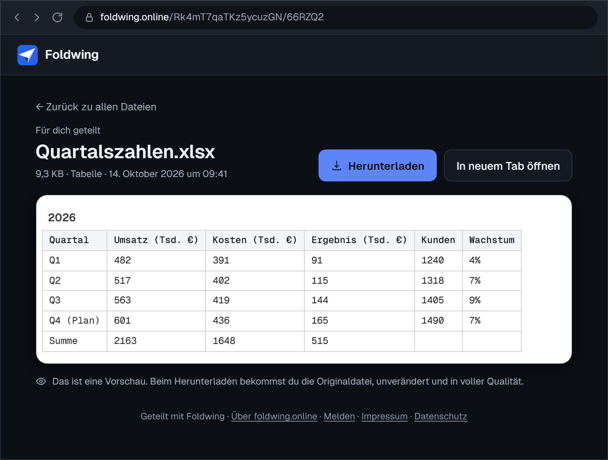

<p align="center"></p>

<h1 align="center">Foldwing</h1>

<p align="center">
  <b>Dateien per Link teilen, direkt von deinem eigenen PC.</b><br>
  Dateien ins Fenster ziehen, Link bekommen: Empfänger sehen sie im Browser als Vorschau und laden die Originale herunter.
</p>

<p align="center">
  <a href="https://github.com/FynnXland/foldwing/releases/latest"></a>
  <a href="LICENSE"></a>
  
</p>

<p align="center">
  <a href="https://github.com/FynnXland/foldwing/releases/latest"><b>Download</b></a> &nbsp;·&nbsp;
  <a href="#download">Alle Dateien</a> &nbsp;·&nbsp; <a href="README.md">English</a> &nbsp;·&nbsp; <a href="docs/">Dokumentation</a>
</p>

<p align="center">
  
  <br><i>Mehrere Dateien, ein Link. Das ZIP ist unkomprimiert, jede Datei darin bleibt bit-identisch.</i>
</p>

Foldwing funktioniert wie WeTransfer, nur bleiben deine Dateien auf deinem PC und werden von
dort ausgeliefert. Du ziehst eine oder mehrere Dateien ins Fenster und bekommst einen Link; wer
ihn öffnet, sieht eine Vorschau im Browser und lädt das Original herunter, Bit für Bit. Ohne
Konto und ohne Einrichtung gehen die Links überall, denn sie laufen über einen kleinen
öffentlichen Relay, der Seiten durchreicht und Downloads direkt zu deinem PC schickt. Willst
du lieber alles im eigenen Netzwerk behalten oder deine eigene Domain nutzen, ist das eine
Einstellung. Kein Abo, keine Telemetrie, und deine Links bleiben online, solange Foldwing auf
deinem PC läuft.

> [!NOTE]
> Die Oberfläche und die Seiten, die deine Empfänger sehen, gibt es bisher nur auf Deutsch,
> auch wenn du mit jemandem teilst, der kein Deutsch spricht.

## So funktioniert es



Geteilte Dateien liegen auf deinem PC, und bevor der Link erscheint, prüft der Virenscanner
deines Systems jede einzelne. Ein eingebauter Webserver liefert Freigabe-Seiten, Vorschauen und
Downloads aus, allerdings nur, solange etwas geteilt ist. In der Standard-Betriebsart öffnet
Foldwing einen Cloudflare Quick Tunnel (ohne Konto) und sagt dem Relay unter
`foldwing.online`, wo dein PC gerade erreichbar ist. Ruft jemand den Link auf, reicht der Relay
die Seite durch und leitet den Download an den Tunnel deines PCs weiter; Dateien speichert er
nicht, und in ihren Inhalt schaut er nicht hinein. Die Seiten führen keine Skripte aus,
Vorschauen entstehen auf deinem PC. Mehr dazu (englisch):
[docs/architecture.md](docs/architecture.md) und [docs/relay.md](docs/relay.md).

## Betriebsarten

Die Betriebsart wählst du im Reiter *Einstellungen* unter *Links* oder mit *Ändern* in der
Statuszeile über der Ablage.

| Betriebsart | So sehen Links aus | Was deinen PC verlässt |
|---|---|---|
| **Internet** (Standard): *Über das Internet* | `https://foldwing.online/<id>`, gehen überall | Tunnel-Adresse und eine Kennung gehen an den Relay. Seiten laufen durch den Relay, Dateien über den Quick Tunnel direkt zum Empfänger. Beides transportiert Cloudflare. |
| **Eigenes Netzwerk**: *Nur im eigenen Netzwerk* | `http://192.168.1.20:8787/s/<id>`, gehen auf Geräten im selben Netzwerk | Nichts geht an fremde Dienste. |
| **Eigene Domain**: *Über deine eigene Domain* ([Anleitung](docs/cloudflare-tunnel.de.md)) | `https://share.example.com/s/<id>`, gehen überall | Downloads laufen durch deinen eigenen Cloudflare-Tunnel, der Relay ist nicht beteiligt. Du brauchst ein kostenloses Cloudflare-Konto und eine Domain darin. |

Wechselst du die Betriebsart, ändert sich der Link jeder Freigabe. Früher verschickte Links
gehen dann erst wieder, wenn du zurückwechselst.

## Funktionen

- **Links, die überall gehen, ohne Konto.** Beim ersten Internet-Link erklärt ein kurzer
  Hinweis den Relay; nach *Okay, Link erstellen* erledigt Foldwing den Rest.
- **Ein Link für viele Dateien.** Bis zu 100 Dateien werden zu einer Freigabe. Empfänger
  öffnen jede Datei einzeln oder laden alle zusammen als ZIP.
- **Vorschau im Browser** für Bilder, Videos (mit Vorspulen), Audio, PDF, Word (.docx), Excel
  (.xlsx, .xls) und CSV, Text und Code sowie den Inhalt von ZIP-Archiven. Word, Excel, CSV,
  Text und ZIP bereitet dein PC auf; Bilder, Video, Audio und PDF zeigt der Browser des
  Empfängers direkt aus der Originaldatei. Einen Online-Viewer gibt es nicht.
- **Immer das Original.** Ein Download ist die unveränderte Datei, Vorschauen ändern sie nie.
- **Ablauf pro Freigabe:** 1 Stunde, 24 Stunden, 7 Tage, 30 Tage oder permanent (Standard).
  Abgelaufene Freigaben werden gelöscht.
- **Virenscan vor dem Link** (standardmäßig an): unter Windows mit Windows Defender, unter
  Linux mit ClamAV, sofern installiert. Meldet der Scanner Schadsoftware, wird die Freigabe
  abgelehnt. Fehlt ein Scanner, scheitert er oder dauert er länger als 5 Minuten, wird die
  Datei ohne Prüfung geteilt.
- **Screenshots als Link.** <kbd>Druck</kbd> drücken, ein Fenster anklicken oder mit der
  Pixel-Lupe einen Bereich aufziehen, dann als Link teilen, kopieren, speichern oder bearbeiten.
- **Teilen per Rechtsklick.** *Mit Foldwing teilen* legt den Link direkt in die Zwischenablage.

<details>
<summary><b>Weitere Funktionen</b></summary>

- **Updates von GitHub:** Der Windows-Installer und das AppImage aktualisieren sich selbst; die
  portable Version und das .deb sagen dir, wenn es eine neue Version gibt. Die Prüfung lässt sich abschalten.
- **Leise im Hintergrund:** Foldwing startet mit dem System im Infobereich; Server und Tunnel
  laufen nur, solange etwas geteilt ist.
- **Suche** über alle Freigaben, auch über die Dateien in einer Sammlung.
- **Freigabe-Seiten ohne JavaScript:** Sie passen sich an Handy-Bildschirme an und folgen der Hell- oder Dunkel-Einstellung des Besuchers.
- **Warnung bei Programmen:** Dateien wie .exe, .msi oder .bat sind auf der Freigabe-Seite markiert.
- **Große Dateien:** Uploads und Downloads laufen gestreamt, und Empfänger können in Videos an jede Stelle springen.
- ***Jeden Screenshot auch als Datei ablegen:*** eine Kopie behalten, auch wenn du ihn nur teilst oder kopierst.
- **Tooltip im Infobereich** mit deinem Screenshot-Kürzel und dem Stand deiner Links.
- **Helles und dunkles Design.**

</details>

## Ein Blick hinein

<p align="center">
  
</p>

**Deine Freigaben auf einen Blick:** Oben sagt die Statuszeile, wohin die Links führen und ob
sie erreichbar sind. Jede Karte zeigt die Datei oder die Dateien einer Sammlung, den Link mit
*Link kopieren* und wann er abläuft; über das Ablauf-Menü der Karte änderst du das.

<details>
<summary><b>Was deine Empfänger sehen</b></summary>

**Eine Sammlung:** pro Datei eine Zeile mit Vorschaubild oder Symbol, Größe und Art, dazu
*Alle als ZIP herunterladen*.
<p align="center"></p>

**Eine einzelne Datei** aus einer Sammlung, hier eine Tabelle im dunklen Design, mit
*Herunterladen* und *In neuem Tab öffnen*.
<p align="center"></p>

</details>

<sub>Alle Screenshots und das GIF zeigen erfundene Beispieldaten, auch die Geräte-ID in den
Links ist erfunden. Die Oberfläche gibt es nur auf Deutsch, deshalb nutzen beide
Sprachfassungen dieser README dieselben Bilder.</sub>

## Download

| Plattform | Datei auf der [Releases-Seite](https://github.com/FynnXland/foldwing/releases/latest) | Hinweise |
|---|---|---|
| **Windows 10/11** (64 Bit) | `Foldwing-<version>-Setup.exe` (rund 138 MB) | Installiert für dein Konto, ohne Admin-Rechte. Aktualisiert sich selbst. |
| Windows, portabel | `Foldwing-<version>-Portable.exe` (rund 125 MB) | Läuft ohne Installation; kein Rechtsklick-Eintrag, kein Autostart. Meldet neue Versionen. |
| **Linux** (x64) | `Foldwing-<version>-linux.AppImage` (rund 150 MB) | Läuft auf den meisten Distributionen. Aktualisiert sich selbst. Siehe [Linux](#linux). |
| Debian, Ubuntu (x64) | `Foldwing-<version>-linux-amd64.deb` (rund 120 MB) | `sudo apt install ./Foldwing-<version>-linux-amd64.deb`. Meldet neue Versionen. |
| macOS | – | Nicht unterstützt |

Foldwing hält von jeder geteilten Datei eine vollständige Kopie, du brauchst also
Speicherplatz für deine Freigaben.

> [!TIP]
> Foldwing ist nicht signiert, deshalb meldet Windows SmartScreen womöglich „Der Computer
> wurde durch Windows geschützt“: *Weitere Informationen → Trotzdem ausführen*. Ob ein
> Download echt ist, prüfst du mit `SHA256SUMS.txt` aus demselben Release:
> `Get-FileHash .\Foldwing-<version>-Setup.exe -Algorithm SHA256` unter Windows,
> `sha256sum -c SHA256SUMS.txt --ignore-missing` unter Linux.

### Erster Start

Starte Foldwing und zieh eine Datei ins Fenster. Beim ersten Mal erklärt ein Hinweis, dass
Internet-Links über `foldwing.online` laufen, und verlinkt Regeln und Datenschutz des Relays.
Mit *Okay, Link erstellen* geht es los; *Nur im eigenen Netzwerk teilen* bleibt offline. Ein
paar Sekunden später, sobald der Tunnel steht, erscheint eine Karte mit dem Link, und
*Link kopieren* legt ihn in die Zwischenablage.

Beim ersten Start trägt die installierte App außerdem *Mit Foldwing teilen* ins
Rechtsklick-Menü ein und startet ab dann mit dem System, still im Infobereich. Abschalten
kannst du das unter *Einstellungen* → *App* → *Mit Windows starten* (unter Linux *Beim
Anmelden starten*). Im Modus *Nur im eigenen Netzwerk* fragt Windows beim ersten Teilen
eventuell, ob Foldwing in Netzwerken kommunizieren darf: private Netzwerke erlauben.

## Linux

Foldwing gibt es auch für Linux, als AppImage und als .deb. Beide entstehen in GitHub Actions
aus demselben Code wie die Windows-Version. Getestet wird vor allem unter Windows; unter Linux
funktioniert das Wichtigste, Feinheiten können fehlen:

- **Das AppImage braucht FUSE 2.** Fehlt es, bricht der Start mit „AppImages require FUSE to
  run“ ab. Ubuntu 24.04 und neuer: `sudo apt install libfuse2t64`; Ubuntu 22.04 und Debian 12:
  `sudo apt install libfuse2`; Fedora: `sudo dnf install fuse-libs`. Danach die Datei mit
  `chmod +x Foldwing-*.AppImage` ausführbar machen. Leg sie vorher an ihren festen Platz, denn
  Autostart und Rechtsklick-Eintrag zeigen auf genau diese Datei.
- **Symbol im Infobereich unter GNOME:** Ubuntu zeigt es von Haus aus. GNOME unter Debian oder
  Fedora braucht die Erweiterung *AppIndicator and KStatusNotifierItem Support* (Paket
  `gnome-shell-extension-appindicator`, danach ab- und wieder anmelden). Ohne Infobereich läuft
  Foldwing nach dem Schließen unsichtbar weiter. Startest du es noch einmal, ist das Fenster
  wieder da; oder du schaltest *Im Hintergrund weiterlaufen* aus.
- **Keine Screenshots unter Wayland,** dem Standard bei GNOME und KDE: Dort kann Foldwing weder
  das Tastenkürzel abfangen noch den Bildschirm aufnehmen. Es lässt die Taste deshalb frei und
  sagt das unter *Screenshots*. Teilen geht wie gewohnt. Für Screenshots meldest du dich mit
  einer X11-Sitzung an („Ubuntu on Xorg“). Unter X11 braucht der Klick auf ein Fenster
  `x11-utils`; das .deb holt es mit, fürs AppImage `sudo apt install x11-utils`.
- **Virenscan nur mit ClamAV:** Ist ClamAV installiert, prüft Foldwing damit jede Datei.
  `sudo apt install clamav` reicht, braucht aber ein paar Sekunden pro Datei; mit
  `clamav-daemon` geht es schneller. Ohne ClamAV werden Dateien ungeprüft geteilt, und die
  Einstellungen sagen dir das.
- **Deine Daten** liegen in `~/.config/foldwing`, gespeicherte Screenshots im Bilder-Ordner
  unter `Foldwing`.

## Im Alltag

| Taste oder Maus | Was passiert |
|---|---|
| <kbd>Druck</kbd> | Screenshot starten (Standard; ändern unter Einstellungen → *Screenshots*) |
| Ziehen, Klicken, oberer Rand | In der Screenshot-Ansicht: Bereich aufziehen, das Fenster unter dem Mauszeiger anklicken oder an den oberen Rand fahren und klicken für den ganzen Bildschirm |
| <kbd>M</kbd> | Pixel-Lupe ein- oder ausschalten |
| <kbd>Esc</kbd> oder Rechtsklick | Screenshot abbrechen |
| <kbd>Enter</kbd> | In der Leiste nach dem Screenshot: *Link teilen*, lädt hoch und kopiert den Link |
| <kbd>Strg</kbd>+<kbd>C</kbd> | In dieser Leiste: Bild kopieren |

- **Mehrere Dateien auf einmal** werden zu einer Freigabe mit einem Link. Empfänger sehen eine
  Übersicht und können alles als ZIP laden.
- **Rechtsklick auf eine Datei** → *Mit Foldwing teilen*. Unter Windows 11 steckt der Eintrag
  unter *Weitere Optionen anzeigen*. Der Link landet direkt in der Zwischenablage.
- **Ablauf:** Das Menü auf einer Karte (*Läuft nie ab*) stellt 1 Stunde, 24 Stunden, 7 Tage,
  30 Tage oder *Nie* ein. Den Standard für neue Freigaben findest du unter *Einstellungen* →
  *Freigaben* → *Ablauf neuer Freigaben*. Ein abgelaufener Link geht sofort nicht mehr, seine
  Dateien sind spätestens eine Minute später gelöscht.
- **Löschen** mit dem Papierkorb-Symbol und *Wirklich löschen?*; der Link geht sofort nicht mehr.
- **Nach einem Screenshot** speichert die Leiste ihn auch in *Bilder\Foldwing* (oder im
  *Speicherordner* aus Einstellungen → *Screenshots*) oder öffnet ihn zum Bearbeiten.
- **Infobereich:** Schließt du das Fenster, läuft Foldwing weiter, die Links bleiben online,
  und die Screenshot-Taste funktioniert. Rechtsklick auf das Symbol → *Beenden* stoppt die App.

## Datenschutz und deine Daten

Foldwing hat kein Konto und keine Telemetrie, und die Freigabe-Seiten laden nichts von
anderswo, nicht einmal Schriften. Ein Passwort haben Links nicht: Wer einen Link hat, kann ihn
öffnen, bis du die Freigabe löschst oder sie abläuft. Online geht Foldwing in diesen Fällen:

| Wann | Was geht wohin |
|---|---|
| Du teilst etwas im Modus *Internet* | Das mitgelieferte cloudflared öffnet einen Quick Tunnel zu Cloudflare. Danach meldet sich Foldwing bei `foldwing.online` an: mit einer zufälligen Geräte-ID, einem Geheimnis (der Relay behält nur dessen Hash), der Tunnel-Adresse und der App-Version. Das wiederholt sich alle 6 Stunden, solange etwas geteilt ist; eine Minute nach der letzten Freigabe meldet sich die App ab. |
| Jemand öffnet einen Internet-Link | Die Seite geht von deinem PC durch den Tunnel und den Relay zu dieser Person. Die Datei selbst, und auch Bilder und Videos auf der Seite, kommen direkt aus deinem Tunnel; der Relay leitet nur weiter. Dein PC sieht die IP-Adresse des Empfängers, wie bei jedem direkten Download. |
| *Eigene Domain* ist eingerichtet und etwas ist geteilt | cloudflared hält eine Verbindung zu deinem Cloudflare-Konto, Downloads laufen über Cloudflare. |
| Update-Prüfung (standardmäßig an) | Etwa 20 Sekunden nach dem Start und dann alle 6 Stunden fragt Foldwing bei GitHub nach einer neuen Version; Installer und AppImage laden sie gleich herunter. Abschalten unter Einstellungen → *Updates* → *Automatisch nach Updates suchen*. |
| Virenscan (standardmäßig an) | Windows Defender bzw. ClamAV prüft auf deinem PC. Ob Defender Proben an Microsoft schickt, hängt an deinen Windows-Einstellungen, nicht an Foldwing. |

Pro Gerät speichert der Relay nur die Geräte-ID, den Hash des Geheimnisses, die aktuelle
Tunnel-Adresse, ob das Gerät online ist und wann er es zuerst und zuletzt gesehen hat. Geräte,
die sich 30 Tage nicht gemeldet haben, löscht er; IP-Adressen, Dateinamen oder Protokolle hebt
er nicht auf ([docs/relay.md](docs/relay.md), englisch). Im Modus *Nur im eigenen Netzwerk*
geht nichts an den Relay oder an Cloudflare.

| Wo (Windows) | Was |
|---|---|
| `%APPDATA%\foldwing\shares\` | Deine geteilten Dateien, unverändert unter Zufallsnamen, dazu pro Freigabe eine kleine `.json` mit Namen, Typen, Größen, Erstellzeit und Ablauf |
| `%APPDATA%\foldwing\foldwing-config.json` | Einstellungen. Das Relay-Geheimnis liegt dort verschlüsselt für dein Windows-Konto, ein Tunnel-Token für die eigene Domain im Klartext. |
| `%LOCALAPPDATA%\foldwing-updater\` | Eine Kopie des Installers und heruntergeladene Updates |
| *Bilder\Foldwing* oder dein *Speicherordner* | Screenshots, die du speicherst |
| `%TEMP%\Foldwing\` | Kopien von Screenshots, die du zum Bearbeiten geöffnet hast; nach einer Stunde gelöscht, beim nächsten Bearbeiten |

Die Deinstallation entfernt das Programm, den Rechtsklick-Eintrag und den Autostart, aber
nicht deine Daten. Für alles zusammen lösch zusätzlich `%APPDATA%\foldwing`,
`%LOCALAPPDATA%\foldwing-updater` und gespeicherte Screenshots. Sicherheitslücken: siehe
[SECURITY.md](SECURITY.md).

## Wenn etwas nicht geht

| Problem | Was du tun kannst |
|---|---|
| **Empfänger sehen „Der Rechner, auf dem diese Datei liegt, ist gerade nicht online.“** | Links gehen nur, solange Foldwing läuft und dein PC wach und online ist. Direkt nach dem Teilen braucht der Tunnel ein paar Sekunden. Das Fenster zu schließen ist kein Problem; *Beenden* im Infobereich nimmt die Links vom Netz. |
| **Der Status bleibt bei *Wartet auf dich*** | Der Hinweis zu Internet-Links ist noch offen. Öffne das Foldwing-Fenster und bestätige ihn. |
| **Der Status sagt, das Gerät ist gesperrt** | Nach einer Meldung hat der Relay dieses Gerät gesperrt. Im eigenen Netzwerk kannst du weiter teilen. Hältst du das für einen Fehler, schreib an die Kontaktadresse auf [foldwing.online/_/](https://foldwing.online/_/) und nenn die Geräte-ID, die die App zeigt. |
| **Nach einer Änderung gehen Links nicht mehr** | Ein Wechsel unter Einstellungen → *Links* ändert jeden Link. Schick den neuen Link oder wechsle zurück. |
| **Andere im Netzwerk erreichen einen Link nicht** (*Nur im eigenen Netzwerk*) | Hast du die Windows-Frage beim ersten Teilen abgelehnt, erlaube Foldwing für private Netzwerke unter *Windows-Sicherheit → Firewall- & Netzwerkschutz → Zugriff von App durch Firewall zulassen*. Gäste-WLANs trennen Geräte oft voneinander. |
| **Netzwerk-Links zeigen die falsche Adresse** (VPN, Hyper-V oder WSL) | Foldwing nimmt die erste nicht interne IPv4-Adresse deines PCs, und die kann zu einem virtuellen Netzwerkadapter gehören. Trenn das VPN oder nimm den Modus *Internet*. |
| **<kbd>Druck</kbd> öffnet das Snipping Tool** | Windows beansprucht die Taste für sich. Schalte in den Windows-Einstellungen *Taste „Drucken“ zum Öffnen der Bildschirmaufnahme verwenden* aus (*Barrierefreiheit → Tastatur*, in manchen Versionen *Bluetooth und Geräte → Tastatur*) oder wähl unter Einstellungen → *Screenshots* → *Tastenkürzel* eine andere Taste. |
| **In den Einstellungen steht *Ruht*** | Kein Fehler. Es ist nichts geteilt, deshalb sind Server und Tunnel aus. Sie starten von selbst, sobald du etwas teilst. |
| **Ein Link braucht eine Weile** | Der Virenscanner prüft jede Datei vorher, große Dateien dauern länger. Ein Scan, der nach 5 Minuten nicht fertig ist, wird übersprungen. Abschalten kannst du ihn unter *Einstellungen* → *Freigaben* → *Dateien auf Schadsoftware prüfen*. |
| **SmartScreen oder Defender warnt vor dem Download** | Foldwing ist nicht signiert. Vergleich den SHA-256-Wert mit `SHA256SUMS.txt` im Release. Stimmt er und Defender schlägt trotzdem an, melde den Fehlalarm unter [microsoft.com/wdsi/filesubmission](https://www.microsoft.com/wdsi/filesubmission) und sag uns in einem [Issue](https://github.com/FynnXland/foldwing/issues) Bescheid. |
| ***Verbindung testen* schlägt fehl** (eigene Domain) | Siehe „Wenn etwas nicht geht“ in der [Tunnel-Anleitung](docs/cloudflare-tunnel.de.md#wenn-etwas-nicht-geht). |

## Eigenen Relay betreiben

Der Relay ist ein Cloudflare Worker mit einer D1-Datenbank, sein Code liegt in
[worker/relay/](worker/relay/README.md). Pflegst du einen Fork, kannst du deinen eigenen auf
einem kostenlosen Cloudflare-Konto mit eigener Domain betreiben: den Worker nach seiner README
deployen, `DEFAULT_RELAY_URL` in `src/main/relay.ts` auf deine Adresse setzen und die App
bauen. Dein Relay zeigt dann dein Impressum, deinen Datenschutz und deine Regeln, und Meldungen
landen bei dir. Wie der Relay arbeitet und was er prüft: [docs/relay.md](docs/relay.md).

## Aus dem Quelltext bauen

Du brauchst Git und ein aktuelles Node.js LTS:

```powershell
git clone https://github.com/FynnXland/foldwing.git
cd foldwing
npm ci
npm run dev          # aus dem Quelltext starten (installiertes Foldwing vorher beenden)
npm test             # rund 300 Tests, offline; Cloudflare, Relay und Virenscanner sind ersetzt
npm run typecheck
npm run dist:win     # Windows: Installer und portable App in release\
npm run dist:linux   # Linux: AppImage und .deb in release/
```

Beide `dist`-Befehle laden cloudflared in einer festen Version und prüfen dessen SHA-256. Zum
Einstieg: [CONTRIBUTING.md](CONTRIBUTING.md) und [docs/architecture.md](docs/architecture.md)
(beide englisch). Code-Kommentare, Oberfläche und [CHANGELOG](CHANGELOG.md) sind deutsch.

## Danksagung

Foldwing baut auf der Arbeit anderer auf: [Electron](https://www.electronjs.org) und
[React](https://react.dev) für die App, [cloudflared](https://github.com/cloudflare/cloudflared)
von Cloudflare für den Tunnel, [mammoth](https://github.com/mwilliamson/mammoth.js) für die
Word-Vorschau, [SheetJS](https://sheetjs.com) für die Tabellen-Vorschau, die
[Geist](https://github.com/vercel/geist-font)-Schriften von Vercel und
[electron-builder](https://www.electron.build) für Installer und Updates.

## Rechtliches

**Lizenz.** Foldwing ist freie Software unter der [MIT-Lizenz](LICENSE). Die fertige App enthält
außerdem Komponenten anderer unter deren eigenen Lizenzen; die Liste steht in
[THIRD-PARTY-NOTICES.md](THIRD-PARTY-NOTICES.md).

**Der öffentliche Relay.** Internet-Links laufen über foldwing.online, einen Relay, den eine
Privatperson kostenlos betreibt. Er reicht Anfragen an deinen Rechner durch und speichert keine
Dateien. Regeln, Datenschutz und Impressum findest du über
[foldwing.online/_/](https://foldwing.online/_/). Der Relay kann sich ändern, langsamer werden
oder eingestellt werden. Wenn du dich auf Links verlassen musst, nimm eine eigene Domain mit
eigenem Cloudflare-Konto ([Anleitung](docs/cloudflare-tunnel.de.md)); dann ist der Relay nicht
beteiligt.

**Was du teilst, verantwortest du.** Teile nur Dateien, die du teilen darfst. Links mit
rechtswidrigen Inhalten werden gesperrt. Melden kannst du so einen Link über „Melden“ unten auf
jeder Freigabe-Seite.

**Keine Gewährleistung.** Die Software kommt ohne Gewähr, wie es die MIT-Lizenz sagt. Soweit
deutsches Recht gilt, haftet der Maintainer nur für Vorsatz und grobe Fahrlässigkeit; für
Schäden an Leben, Körper oder Gesundheit gilt das Gesetz.

**Datenschutz.** Die App hat keine Konten und keine Telemetrie. Sie fragt bei GitHub nach Updates
(lässt sich in den Einstellungen abschalten) und baut für Internet-Links einen Cloudflare Quick
Tunnel auf. Genaueres steht in der Datenschutzerklärung des Relay.

Cloudflare ist eine Marke von Cloudflare, Inc. Foldwing gehört nicht zu Cloudflare.

## Lizenz

Sofern du nichts anderes angibst, steht jeder Beitrag, den du zur Aufnahme in Foldwing
einreichst, unter der MIT-Lizenz, ohne zusätzliche Bedingungen.

Copyright © 2026 FynnXland
