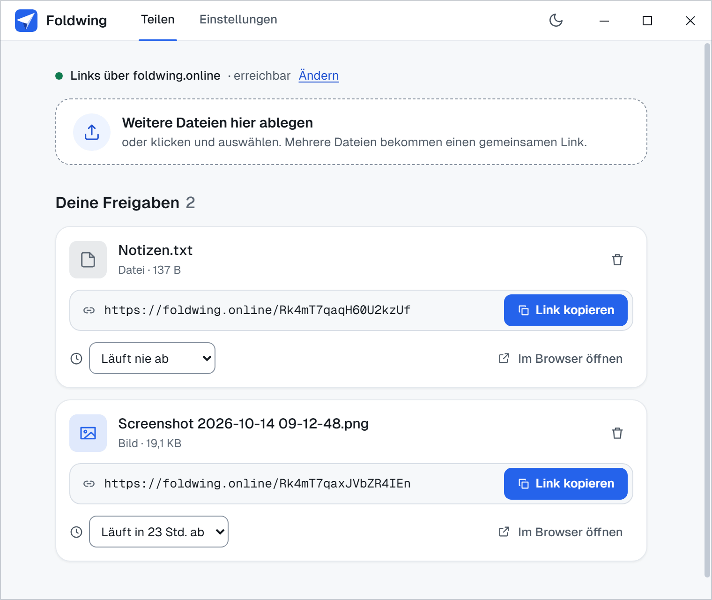
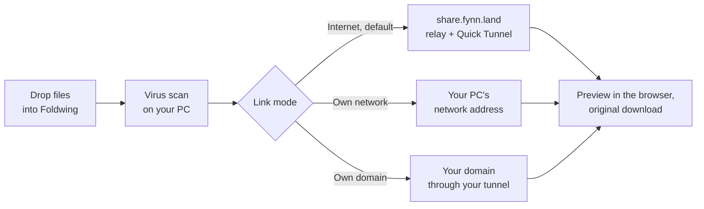
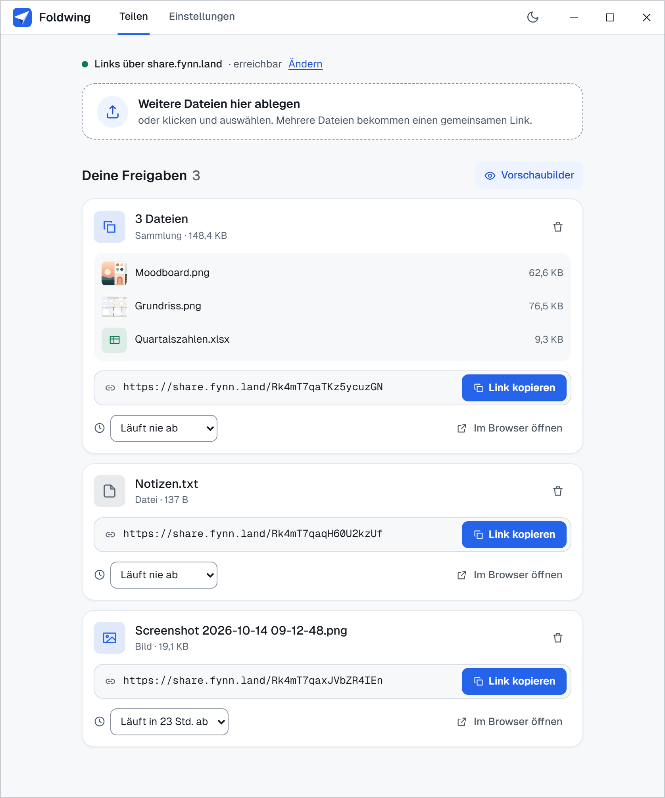
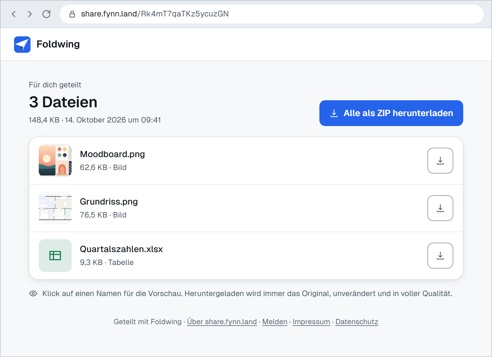
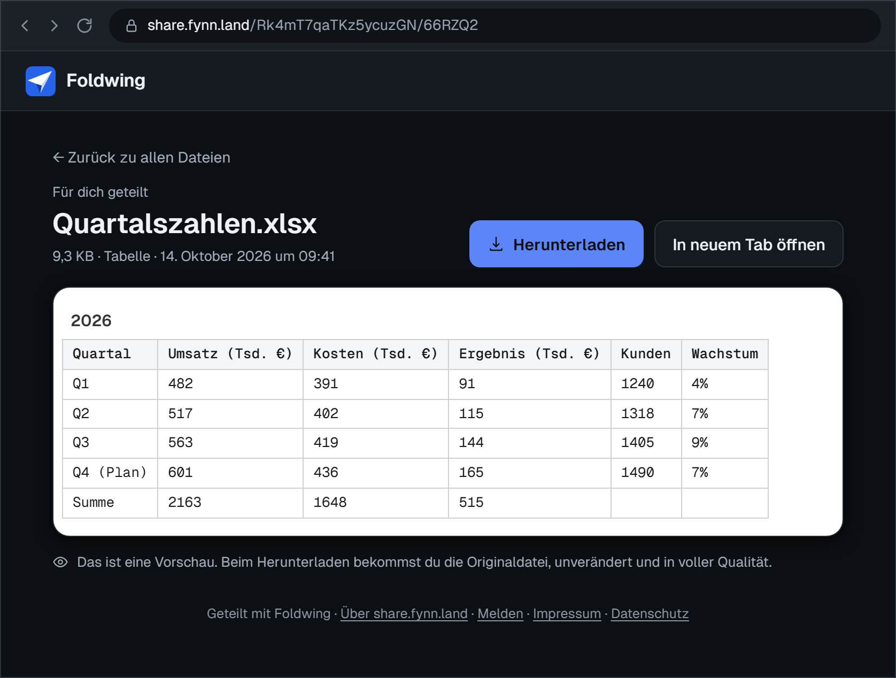

<p align="center"></p>

<h1 align="center">Foldwing</h1>

<p align="center">
  <b>Share files by link, straight from your own PC.</b><br>
  Drop files into the window and get a link: recipients preview them in the browser and download the originals.
</p>

<p align="center">
  <a href="https://github.com/FynnXland/foldwing/releases/latest"></a>
  <a href="LICENSE"></a>
  
</p>

<p align="center">
  <a href="https://github.com/FynnXland/foldwing/releases/latest"><b>Download</b></a> &nbsp;·&nbsp;
  <a href="#download">All files</a> &nbsp;·&nbsp; <a href="README.de.md">Deutsch</a> &nbsp;·&nbsp; <a href="docs/">Documentation</a>
</p>

<p align="center">
  
  <br><i>Several files, one link. The ZIP is uncompressed, so every file in it stays bit-identical.</i>
</p>

Foldwing works like WeTransfer, except that your files stay on your PC and are served from
there. Drop in one or more files and you get a link; whoever opens it sees a preview in the
browser and downloads the original, bit for bit. Links work anywhere out of the box, with no
account and nothing to set up: they run through a small public relay that passes pages on and
sends downloads straight to your PC. If you'd rather keep everything in your own network, or
use your own domain, that's one setting away. No subscription, no telemetry, and your links
stay online as long as Foldwing runs on your PC.

> [!NOTE]
> Foldwing's interface and the pages your recipients see are in German. This README gives
> German labels as they appear on screen, with their meaning in brackets: *Link kopieren* (Copy link).

## How it works



Foldwing keeps shared files on your PC and has the local virus scanner check every file
before the link appears. A web server built into the app delivers share pages, previews and
downloads, but only while something is shared. In the default mode, Foldwing opens a
Cloudflare Quick Tunnel (no account needed) and tells the relay at `share.fynn.land` where your
PC can be reached. A recipient's browser asks the relay, which passes the page through and
redirects the download to your PC's tunnel; the relay stores no files and never sees their
contents. The pages run no scripts, and previews are made on your PC. Details:
[docs/architecture.md](docs/architecture.md) and [docs/relay.md](docs/relay.md).

## Modes

Choose the mode on the *Einstellungen* (Settings) tab → *Links*, or with *Ändern* (Change) in
the status line above the drop zone.

| Mode | Links look like | What leaves your PC |
|---|---|---|
| **Internet** (default): *Über das Internet* (Over the internet) | `https://share.fynn.land/<id>`, open anywhere | Your PC's tunnel address and an ID go to the relay. Pages pass through the relay; files go through the Quick Tunnel straight to the recipient. Cloudflare carries both. |
| **Own network**: *Nur im eigenen Netzwerk* (Only in your own network) | `http://192.168.1.20:8787/s/<id>`, open on devices in the same network | Nothing goes to outside services. |
| **Own domain**: *Über deine eigene Domain* (Over your own domain, [guide](docs/cloudflare-tunnel.md)) | `https://share.example.com/s/<id>`, open anywhere | Downloads travel through your own Cloudflare Tunnel. The relay isn't involved. Needs a free Cloudflare account and a domain on it. |

Switching the mode changes the link of every share. Links you sent earlier stop working until
you switch back.

## Features

- **Links that work anywhere without an account.** The first internet link shows a short note
  about the relay; after *Okay, Link erstellen* (Okay, create link) Foldwing does the rest.
- **One link for many files.** Up to 100 files become one share. Recipients open each file or
  download all of them as a ZIP.
- **Previews in the browser** for images, video (with seeking), audio, PDF, Word (.docx), Excel
  (.xlsx, .xls) and CSV, text and code, and the contents of ZIP archives. Word, Excel, CSV, text
  and ZIP previews are made on your PC; images, video, audio and PDF are shown by the
  recipient's browser straight from the original file. There is no online viewer.
- **Always the original.** A download is the untouched file; previews never change it.
- **Expiry per share:** 1 hour, 24 hours, 7 days, 30 days or permanent (the default). Expired
  shares are deleted.
- **Virus scan before the link** (on by default): Windows Defender on Windows, ClamAV on Linux
  if it is installed. If the scanner finds malware, the share is refused. Without a scanner,
  on a scanner error or after 5 minutes, the file is shared without a scan.
- **Screenshots as links.** Press <kbd>Print Screen</kbd>, click a window or drag an area with
  the pixel magnifier, then share it as a link, copy, save or edit it.
- **Right-click to share.** *Mit Foldwing teilen* (Share with Foldwing) puts the link
  straight on the clipboard.

<details>
<summary><b>More features</b></summary>

- **Updates from GitHub:** the Windows installer and the AppImage update themselves; the
  portable app and the .deb tell you when a new version is out. You can turn the check off.
- **Quiet in the background:** Foldwing starts with your system in the notification area;
  the server and the tunnel only run while something is shared.
- **Search** across your shares, including the files inside a collection.
- **Share pages without JavaScript:** they adapt to phone screens and follow the visitor's light or dark setting.
- **Warning for executables:** share pages flag files such as .exe, .msi or .bat.
- **Large files:** uploads and downloads are streamed, and recipients can jump to any point of a video.
- ***Jeden Screenshot auch als Datei ablegen*** (Also save every screenshot as a file): keep a copy, even when you only share or copy it.
- **Tooltip in the notification area** with your screenshot shortcut and whether your links are online.
- **Light and dark theme.**

</details>

## A look inside

<p align="center">
  
</p>

**Your shares at a glance:** the status line on top says where links go and whether they are
reachable. Every card shows the file, or the files of a collection, the link with *Link
kopieren* (Copy link) and when it expires; the expiry menu on the card changes that.

<details>
<summary><b>What your recipients see</b></summary>

**A collection:** one row per file with a thumbnail or an icon, size and type, plus
*Alle als ZIP herunterladen* (Download all as ZIP).
<p align="center"></p>

**A single file** from a collection, here a spreadsheet in the dark theme, with *Herunterladen*
(Download) and *In neuem Tab öffnen* (Open in new tab).
<p align="center"></p>

</details>

<sub>All screenshots and the GIF show invented sample data, and the links in them contain an
invented device ID. The interface only exists in German, so both language versions of this
README use the same images.</sub>

## Download

| Platform | File on the [Releases page](https://github.com/FynnXland/foldwing/releases/latest) | Notes |
|---|---|---|
| **Windows 10/11** (64-bit) | `Foldwing-<version>-Setup.exe` (about 138 MB) | Installs for your account, without admin rights. Updates itself. |
| Windows, portable | `Foldwing-<version>-Portable.exe` (about 125 MB) | Runs without installing; no right-click entry, no autostart. Tells you about new versions. |
| **Linux** (x64) | `Foldwing-<version>-linux.AppImage` (about 150 MB) | Runs on most distributions. Updates itself. See [Linux](#linux). |
| Debian, Ubuntu (x64) | `Foldwing-<version>-linux-amd64.deb` (about 120 MB) | `sudo apt install ./Foldwing-<version>-linux-amd64.deb`. Tells you about new versions. |
| macOS | – | Not supported |

Foldwing keeps a full copy of every shared file, so you need disk space for your shares.

> [!TIP]
> Foldwing isn't code-signed, so Windows SmartScreen may say "Windows protected your PC":
> choose *More info → Run anyway*. To check that a download is genuine, compare its hash with
> `SHA256SUMS.txt` from the same release:
> `Get-FileHash .\Foldwing-<version>-Setup.exe -Algorithm SHA256` on Windows,
> `sha256sum -c SHA256SUMS.txt --ignore-missing` on Linux.

### First run

Start Foldwing and drop a file into the window. The first time, a note explains that internet
links run through `share.fynn.land` and links to the relay's rules and privacy notice. Choose
*Okay, Link erstellen* (Okay, create link), or *Nur im eigenen Netzwerk teilen* (Share only in
your own network) to stay offline. A card with the link appears a few seconds later, once the
tunnel is up; *Link kopieren* (Copy link) puts it on the clipboard.

On its first start the installed app also adds *Mit Foldwing teilen* to the right-click menu
and from then on starts with your system, quietly in the notification area. You can turn that
off under *Einstellungen* → *App* → *Mit Windows starten* (Start with Windows; on
Linux *Beim Anmelden starten*). In *Nur im eigenen Netzwerk* mode, Windows may ask whether to
let Foldwing communicate on networks the first time you share something: allow private
networks.

## Linux

Foldwing is also available for Linux, as an AppImage and a .deb, both built on GitHub Actions
from the same code as the Windows version. Testing happens mostly on Windows. On Linux the
essentials work, but some details may be missing:

- **AppImage needs FUSE 2.** Without it, the start fails with "AppImages require FUSE to run".
  Ubuntu 24.04 and newer: `sudo apt install libfuse2t64`; Ubuntu 22.04 and Debian 12:
  `sudo apt install libfuse2`; Fedora: `sudo dnf install fuse-libs`. Then make the file
  executable with `chmod +x Foldwing-*.AppImage`. Put it in its final place first: autostart
  and the right-click entry point to that file.
- **Tray icon under GNOME:** Ubuntu shows it out of the box. GNOME on Debian or Fedora needs the
  extension *AppIndicator and KStatusNotifierItem Support* (package
  `gnome-shell-extension-appindicator`, then log out and back in). Without a tray, Foldwing
  keeps running unseen after you close the window; start it again to get the window back, or
  switch off *Im Hintergrund weiterlaufen* (Keep running in the background).
- **No screenshots under Wayland,** the default on GNOME and KDE: there, Foldwing can't catch
  the shortcut or capture the screen, so it leaves the key free and says so under *Screenshots*.
  Sharing works as usual. For screenshots, log in with an X11 session ("Ubuntu on Xorg").
  Under X11, clicking a window uses `x11-utils`; the .deb pulls it in, for the AppImage install
  it with `sudo apt install x11-utils`.
- **Virus scan is optional:** Foldwing uses ClamAV if it is installed. `sudo apt install
  clamav` works but takes a few seconds per file; `clamav-daemon` is faster. Without ClamAV,
  files are shared unscanned, and the settings tell you so.
- **Your data** lives in `~/.config/foldwing`. Saved screenshots go to your pictures folder
  under `Foldwing`.

## Everyday use

| Key or mouse | What it does |
|---|---|
| <kbd>Print Screen</kbd> | Start a screenshot (default; change it under Settings → *Screenshots*) |
| Drag, click, top edge | In the screenshot view: drag over an area, click the window under the cursor, or move to the top edge and click for the whole screen |
| <kbd>M</kbd> | Turn the pixel magnifier on or off |
| <kbd>Esc</kbd> or right-click | Cancel the screenshot |
| <kbd>Enter</kbd> | In the bar after a screenshot: *Link teilen* (Share link), uploads it and copies the link |
| <kbd>Ctrl</kbd>+<kbd>C</kbd> | In that bar: copy the image |

- **Several files at once** become one share with one link. Recipients see an overview and can
  download everything as a ZIP.
- **Right-click a file** → *Mit Foldwing teilen*. On Windows 11 it sits under *Show more
  options*. The link goes straight to the clipboard.
- **Expiry:** the menu on a card (*Läuft nie ab*, Never expires) sets 1 hour, 24 hours, 7 days,
  30 days or *Nie* (Never). The default for new shares is under *Einstellungen* → *Freigaben* →
  *Ablauf neuer Freigaben*. An expired link stops working at once, and its files are deleted
  within a minute.
- **Delete** a share with the bin icon and confirm with *Wirklich löschen?* (Really delete?);
  its link stops working right away.
- **After a screenshot**, the bar also saves it to *Pictures\Foldwing* (or the
  *Speicherordner* (save folder) set under *Einstellungen* → *Screenshots*) or opens it for editing.
- **Notification area:** closing the window keeps Foldwing running, so links stay online and
  the screenshot key keeps working. Right-click the icon → *Beenden* (Quit) to stop it.

## Privacy and your data

Foldwing has no account and no telemetry, and the share pages load nothing from elsewhere,
not even fonts. Links have no password: anyone who has a link can open it until you delete the
share or it expires. Foldwing goes online in these cases:

| When | What goes where |
|---|---|
| You share something in *Internet* mode | The bundled cloudflared opens a Quick Tunnel to Cloudflare. Foldwing then registers with `share.fynn.land`: a random device ID, a secret (the relay keeps only its hash), the tunnel address and the app version. It repeats this every 6 hours while something is shared and signs off a minute after the last share is gone. |
| Someone opens an internet link | The page goes from your PC through the tunnel and the relay to that person. The file itself, and images and video on the page, come from your tunnel directly; the relay only redirects. Your PC sees the recipient's IP address, as with any direct download. |
| *Eigene Domain* is set up and something is shared | cloudflared keeps a connection to your Cloudflare account, and downloads pass through Cloudflare. |
| Update check (on by default) | About 20 seconds after start and every 6 hours, Foldwing asks GitHub for a new release and, for the installer and the AppImage, downloads it. Turn it off under Settings → *Updates* → *Automatisch nach Updates suchen* (Check for updates automatically). |
| Virus scan (on by default) | Windows Defender or ClamAV scans on your PC. Whether Defender sends samples to Microsoft depends on your Windows settings, not on Foldwing. |

The relay stores per device only the device ID, the hash of the secret, the current tunnel
address, whether it is online and when it was first and last seen. It deletes devices that
haven't been seen for 30 days and keeps no IP addresses, file names or logs
([docs/relay.md](docs/relay.md)). In *Nur im eigenen Netzwerk* mode, nothing goes to the relay
or to Cloudflare.

| Where (Windows) | What |
|---|---|
| `%APPDATA%\foldwing\shares\` | Your shared files, unchanged under random names, plus a small `.json` per share with names, types, sizes, creation time and expiry |
| `%APPDATA%\foldwing\foldwing-config.json` | Settings. The relay secret is encrypted for your Windows account; a tunnel token for your own domain is stored in plain text. |
| `%LOCALAPPDATA%\foldwing-updater\` | A copy of the installer and downloaded updates |
| *Pictures\Foldwing* or your *Speicherordner* | Screenshots you save |
| `%TEMP%\Foldwing\` | Copies of screenshots you opened for editing; deleted after an hour, the next time you edit one |

Uninstalling removes the program, the right-click entry and the autostart entry, but not your
data. To remove everything, also delete `%APPDATA%\foldwing`,
`%LOCALAPPDATA%\foldwing-updater` and any saved screenshots. Security issues: see
[SECURITY.md](SECURITY.md).

## Troubleshooting

| Problem | What to do |
|---|---|
| **Recipients see *Der Rechner, auf dem diese Datei liegt, ist gerade nicht online.*** (The computer that has this file isn't online right now.) | Links only work while Foldwing runs and your PC is awake and online. Right after you share something, the tunnel needs a few seconds. Closing the window is fine; *Beenden* in the notification area takes the links offline. |
| **The status stays at *Wartet auf dich*** (Waiting for you) | The note about internet links is still open. Open Foldwing's window and confirm it. |
| **The status says the device is blocked** | The relay has blocked this device after a report. You can keep sharing in your own network. If you think it's a mistake, write to the contact address on [share.fynn.land/_/](https://share.fynn.land/_/) and name the device ID shown in the app. |
| **Links stopped working after a change** | Switching the mode under Settings → *Links* changes every link. Send the new link, or switch back. |
| **Others in your network can't open a link** (*Nur im eigenen Netzwerk*) | If you declined Windows' question when you first shared something, allow Foldwing for private networks under *Windows Security → Firewall & network protection → Allow an app through firewall*. Guest Wi-Fi networks often keep devices apart. |
| **Network links show the wrong address** (VPN, Hyper-V or WSL) | Foldwing takes the first IPv4 address of your PC that isn't internal, and that can belong to a virtual network adapter. Disconnect the VPN, or use *Internet* mode. |
| **<kbd>Print Screen</kbd> opens the Snipping Tool** | Windows takes the key for itself. Turn off *Use the Print screen key to open screen capture* in the Windows settings (*Accessibility → Keyboard*; on some versions *Bluetooth & devices → Keyboard*), or pick another key under Settings → *Screenshots* → *Tastenkürzel* (Shortcut). |
| **The settings say *Ruht*** (resting) | Not an error. Nothing is shared, so the server and the tunnel are off. They start by themselves as soon as you share something. |
| **A link takes a while to appear** | The virus scanner checks every file first, and big files take longer. A scan that doesn't finish within 5 minutes is skipped. You can turn the scan off under *Einstellungen* → *Freigaben* → *Dateien auf Schadsoftware prüfen* (Scan files for malware). |
| **SmartScreen or Defender warns about the download** | Foldwing isn't code-signed. Compare its SHA-256 with `SHA256SUMS.txt` in the release. If it matches and Defender still flags it, report the false positive at [microsoft.com/wdsi/filesubmission](https://www.microsoft.com/wdsi/filesubmission) and let us know in an [issue](https://github.com/FynnXland/foldwing/issues). |
| ***Verbindung testen* fails** (own domain) | See "Troubleshooting" in the [tunnel guide](docs/cloudflare-tunnel.md#troubleshooting). |

## Running your own relay

The relay is a Cloudflare Worker with a D1 database, and its code is in
[worker/relay/](worker/relay/README.md). If you maintain a fork, you can run your own on a
free Cloudflare account with a domain of your own: deploy the worker as its README describes,
set `DEFAULT_RELAY_URL` in `src/main/relay.ts` to your address and build the app. Your relay
then shows your imprint, privacy notice and rules, and reports go to you. How the relay works
and what it checks: [docs/relay.md](docs/relay.md).

## Building from source

Git and a current Node.js LTS:

```powershell
git clone https://github.com/FynnXland/foldwing.git
cd foldwing
npm ci
npm run dev          # run from source (quit an installed Foldwing first)
npm test             # about 300 tests, offline; Cloudflare, the relay and the scanner are mocked
npm run typecheck
npm run dist:win     # Windows: installer and portable app in release\
npm run dist:linux   # Linux: AppImage and .deb in release/
```

Both `dist` commands download cloudflared in a fixed version and check its SHA-256. Start with
[CONTRIBUTING.md](CONTRIBUTING.md) and [docs/architecture.md](docs/architecture.md). Code
comments, UI texts and the [CHANGELOG](CHANGELOG.md) are in German.

## Acknowledgements

Foldwing builds on the work of others: [Electron](https://www.electronjs.org) and
[React](https://react.dev) for the app, [cloudflared](https://github.com/cloudflare/cloudflared)
by Cloudflare for the tunnel, [mammoth](https://github.com/mwilliamson/mammoth.js) for Word
previews, [SheetJS](https://sheetjs.com) for spreadsheet previews, the
[Geist](https://github.com/vercel/geist-font) fonts by Vercel, and
[electron-builder](https://www.electron.build) for the installers and updates.

## Legal

**License.** Foldwing is free software under the [MIT License](LICENSE). The packaged app also
contains third-party components under their own licenses, listed in
[THIRD-PARTY-NOTICES.md](THIRD-PARTY-NOTICES.md).

**The public relay.** Internet links run through share.fynn.land, a relay that one person runs
privately and for free. It passes requests through to your computer and stores no files. Its
rules, privacy notice and legal notice are linked from
[share.fynn.land/_/](https://share.fynn.land/_/). The relay can change, slow down or stop at any
time. If you need links you can rely on, use your own domain and your own Cloudflare account
([guide](docs/cloudflare-tunnel.md)); then the relay isn't involved.

**What you share is your responsibility.** Only share files you're allowed to share. Links with
illegal content get blocked. To report one, use the "Report" link at the bottom of every shared
page.

**No warranty.** The software comes without warranty, as the MIT License says. Where German law
applies, the maintainer is liable only for intent and gross negligence, except for injury to
life, body or health.

**Privacy.** The app has no accounts and no telemetry. It checks GitHub for updates (you can turn
that off in the settings) and, for internet links, opens a Cloudflare Quick Tunnel. Details are in
the relay's privacy notice.

Cloudflare is a trademark of Cloudflare, Inc. Foldwing is not affiliated with Cloudflare.

## License

Unless you explicitly state otherwise, any contribution you submit for inclusion in Foldwing
is licensed under the MIT License, without additional terms or conditions.

Copyright © 2026 FynnXland
