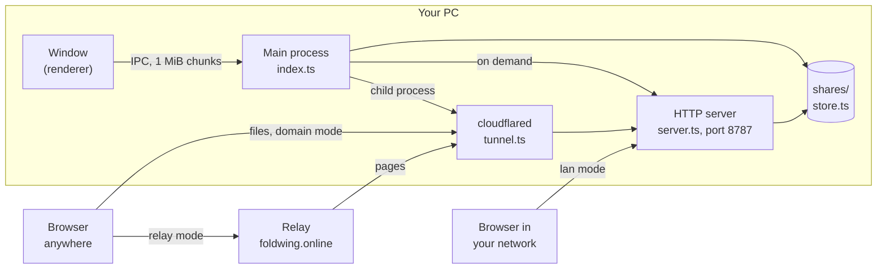

# Foldwing architecture

Status: Foldwing 1.4.2. This page is for contributors: how a file travels from the window to
a recipient's browser, which module does what, and why the server is not always running. The
source code is the final authority. Code comments are in German.

Foldwing is an Electron app (Electron 45) built with electron-vite. It has three parts:

- the **main process** (`src/main/`, Node): files, the embedded HTTP server, cloudflared, the
  relay client, updates, the screenshot hotkey, tray and settings;
- the **renderer** (`src/renderer/`, React): the main window, the screenshot overlay and the
  bar after a screenshot. One bundle serves all three; the role comes from the URL hash
  (`#capture`, `#capture-actions`, otherwise the app). `index.html` contains a loading
  indicator in plain HTML and CSS that shows until React has rendered;
- the **preload** (`src/preload/index.ts`, built as `index.mjs`): the only bridge between the
  two, exposed as `window.foldwing` via `contextBridge`. The renderer has no Node and no file
  access.

Uploads only ever come from the app itself: the window, the right-click entry and screenshots.
The server has no upload endpoint; it only reads what the store holds, and it only runs when
needed (see *Sharing on demand*). Recipients reach it in one of three ways, chosen by
`linkMode`:

| `linkMode` | Link | Server listens on | Tunnel |
|---|---|---|---|
| `relay` (default) | `https://foldwing.online/<T>` | `127.0.0.1` | Quick Tunnel, no account |
| `lan` | `http://<LAN IP>:<port>/s/<S>` | all interfaces | none |
| `domain` | `<publicBaseUrl>/s/<S>` | all interfaces | your own tunnel by token |

`T` is the device ID (8 characters) plus the share ID `S` (10 characters). The relay itself is
described in [relay.md](relay.md).

## From file to link

1. **Upload.** `src/renderer/src/lib/upload.ts` reads each file in 1 MiB slices and hands them
   to the main process: `share:begin`/`share:chunk`/`share:end` for one file,
   `bundle:begin`, `share:chunk` per file and `bundle:end` for a collection of up to 100
   files (`MAX_BUNDLE_FILES` in `index.ts`).
2. **Store.** `ShareStore` (`store.ts`) streams the chunks to disk with backpressure:
   `<id>.bin` for a single file, `<id>-<fid>.bin` for each file of a collection, and on
   completion one `<id>.json` with name, MIME type, size, creation time, expiry and, for a
   collection, the file list. IDs are random base62 strings from `crypto.randomBytes`
   (10 characters per share, 6 per file). Display names lose control characters and are cut
   to 200 characters; they never become file names on disk. If one file of a collection
   fails, the whole collection is discarded.
3. **Virus scan.** With `scanUploads` on (default), `scanner.ts` runs Windows Defender
   (`MpCmdRun.exe -Scan -ScanType 3 -File <path> -DisableRemediation`) or, on Linux,
   `clamdscan`/`clamscan`. Only the "infected" exit code rejects a share; no scanner, an error
   or the 5-minute timeout let it through (fail-open, otherwise sharing would be impossible on
   systems without a scanner). The files of a collection are scanned one after another, and
   one finding rejects the whole collection.
4. **Link.** `shareUrl()` in `index.ts` builds the link for the current mode:
   `relayShareUrl()` from `relay.ts` in relay mode, otherwise `publicBaseUrl` (domain mode) or
   `http://<first non-internal IPv4>:<port>` (`detectLanAddress()` in `config.ts`). Switching
   the mode recomputes the links of all shares.

The right-click entry starts Foldwing with `--fs-share <path>`; a running instance receives
it through the `second-instance` event, a starting one queues it until it is ready. Both paths
and screenshots (`uploadScreenshot()`) use the same store; screenshots are not scanned. The
minute timer (`sweepTick()`) deletes expired shares and aborts uploads that have shown no
activity for ten minutes, for example after the window crashed.

## Path families (`links.ts`)

The same share is reachable under two path families. `routeSharePath()` parses a request path
into page, raw data or font, and the `ShareLinks` builders (`lanLinks()`, `relayLinks()`)
produce the URLs a page links to. A page fetched through a relay path must only link relay
paths, otherwise images, downloads and fonts would point nowhere for the recipient.

| LAN and domain | Relay | Answer |
|---|---|---|
| `/s/<S>` | `/<T>` | Share page of a single file, or the overview of a collection |
| `/s/<S>/<F>` | `/<T>/<F>` | Page of one file of a collection |
| `/f/<S>` | `/<T>/d` | The file itself (HTTP range requests supported); for a collection, all files as one ZIP |
| `/f/<S>/<F>` | `/<T>/<F>/d` | One file of a collection |
| `?dl=1` on raw paths | same | Same file, sent as a download |
| `/_font/<name>.woff2` | `/<T>/_font/<name>.woff2` | The self-hosted Geist fonts |

The server answers relay paths only if `D` (the first 8 characters of `T`) is its own device
ID; anything else is 404. Two more routes exist: `/` (a landing page without content) and
`/api/health`, which returns `{"ok":true,"app":"Foldwing","device":"<D>"|null}` and is used by
the relay's registration check and by *Verbindung testen* (Test connection).

## The HTTP server (`server.ts`)

IDs in paths must be base62. Pages, files and error responses send
`X-Content-Type-Options: nosniff`.

- **HTML pages** (`pages.ts`) are built on the server and contain no JavaScript at all. Their
  `Content-Security-Policy` includes `script-src 'none'`, `base-uri 'none'` and
  `form-action 'none'`; names and other values are HTML-escaped. Pages of the relay family
  have a footer with links to the relay's info page and its report page; the other families
  only say *Geteilt mit Foldwing*.
- **Files** are served inline, except HTML, XHTML, SVG, `text/xml` and `application/xml`,
  which are always sent as an `attachment` so they can't run as a page on the share's origin.
  Every raw response except PDFs also carries
  `Content-Security-Policy: sandbox allow-downloads` as a second line of defence. PDFs are left
  out because Chrome's PDF viewer stays empty inside a sandbox.
- **Previews** are expensive and partly blocking (SheetJS parses synchronously).
  `cachedPreview()` keeps results in an LRU cache (50 entries, 32 MB) and computes only one
  preview at a time, so repeated requests for a known link can't freeze the main process. The
  cache key includes the path family, because preview HTML contains file URLs. The cache is
  cleared when the server stops.

## Previews (`preview.ts`, `zip.ts`)

| Type | How | Limit |
|---|---|---|
| Images, video, audio | ``, `<video>`, `<audio>` pointing at the raw path; the browser streams | none |
| PDF | the browser's own viewer in an `<iframe>` | none |
| Word (.docx) | mammoth converts to HTML, images are skipped | 30 MB |
| Excel (.xlsx, .xls) and CSV | SheetJS (`xlsx`), first 5 sheets; CSV is decoded as UTF-8, otherwise Windows-1252 | 20 MB |
| Text and code | escaped into `<pre>` | first 3 MB shown |
| ZIP | `zip.ts` reads only the central directory at the end of the file, up to 1,000 entries; ZIP64 archives get the generic view | none |

mammoth and SheetJS turn content from the file into HTML and are known to pass attacker text
through (an unescaped `data-v` attribute, `javascript:` links). `sanitizePreviewHtml()`
therefore runs every library result through an allowlist built on a small tokenizer, not on
regular expressions: allowed tags stay (`TABLE_TAGS` for spreadsheets, `DOC_TAGS` for Word),
every attribute is dropped, and `script`, `style`, `iframe` and similar tags disappear with
their content. A second pass checks that only bare allowed tags are left; if not, the preview
falls back to plain escaped text. Generated HTML above 2 MB is replaced by a note. Both
libraries are loaded on first use only.

## The ZIP download (`zip-write.ts`)

A collection downloads as one ZIP that Foldwing writes while sending it. Every entry uses
method 0 (stored, no compression), so the files inside are bit-identical and the archive size
is known in advance: the server sends an exact `Content-Length`, and the browser shows real
progress. Files are read in 64 KB chunks, so memory stays constant; ZIP64 records are added
only when sizes or offsets need them. Entry names are reduced to plain file names and
duplicates are numbered. Range requests are not served for the ZIP (`Accept-Ranges: none`).
If a file disappears mid-stream, the connection is cut rather than sending a truncated
archive that looks complete.

## Sharing on demand (`sharing-policy.ts`)

The server and the tunnel only run when needed. `decideSharing()` is pure and tested; it
knows three reasons:

| Reason | When |
|---|---|
| `shares` | at least one share hasn't expired |
| `upload` | an upload is running |
| `hold` | for two minutes (`HOLD_MS`) after a mode change, saving the domain settings or *Verbindung testen* |

Without a reason, a running server waits 60 seconds (`IDLE_GRACE_MS`) and then stops, so
deleting one share and creating the next doesn't restart anything. `reconcileSharing()` in
`index.ts` asks for a decision after every relevant event (upload start and end, deletion,
new expiry, mode change, the minute timer, a scheduled recheck at the next expiry) and runs
start and stop through one serialized promise chain, so they can't overtake each other.
Stopping signs off from the relay, cuts open connections, frees the port and clears the
preview cache.

`describeLinkStatus()` turns mode, server, tunnel and relay state into one status for the
header, the banner, the settings and the tray tooltip (`trayTooltip()`): *Ruht* (resting),
waiting for the relay note, connecting, online, offline, blocked or error.

## Relay client (`relay.ts`)

`RelayClient` keeps the registration for one tunnel address alive: self-test against
`<tunnel>/api/health` (up to 90 seconds), `POST /_/api/register`, retries and a heartbeat every
6 hours; `disconnect()` sends `POST /_/api/unregister` and clears every timer. Its reactions to
409, 422, 403, 429 and 5xx are listed in [relay.md](relay.md#how-the-app-reacts-to-answers).
Everything Electron provides (timers, `safeStorage`, fetch) comes in by injection, so
`tests/relay.test.ts` runs without the app.

The relay base is the constant `DEFAULT_RELAY_URL` (`https://foldwing.online`); only for tests
and development, `FOLDWING_RELAY_URL` overrides it. The device ID and the secret are created
on first use and stored in the configuration; the secret is encrypted with `safeStorage`
(`encodeSecret()`), or base64 with a `b64:` marker where no keyring is available. The app
registers only after the first-use note (`RelayNotice.tsx`) has been confirmed
(`relay.noticeAccepted`).

## Cloudflare Tunnel (`tunnel.ts`)

`TunnelManager` runs cloudflared as a child process in one of two forms:

- **Quick Tunnel** (relay mode): `tunnel --no-autoupdate --config <userData>/cloudflared-quick.yml
  --url http://127.0.0.1:<port>`. The address is parsed from the output
  (`parseQuickTunnelUrl()`, which skips `api.trycloudflare.com`). The own config file matters:
  without it cloudflared reads `~/.cloudflared/config.yml`, for example from an earlier named
  tunnel, and some versions then refuse the Quick Tunnel. An empty file is an error for
  cloudflared, so it holds one harmless key.
- **Token** (domain mode): `tunnel --no-autoupdate run --token <token>`; the ingress rule is
  set in the Cloudflare dashboard ([cloudflare-tunnel.md](cloudflare-tunnel.md)).

The manager looks for the binary in this order: the path from the configuration, the copy
bundled in `resources/`, the usual install folders, WinGet's link folder, then `PATH`. The
status turns connected when cloudflared reports a registered connection; error lines become
the status text without timestamps, paths or tokens (`cloudflaredErrorLine()`). If the process
exits while the tunnel is wanted, it restarts after 4 seconds. `start()` first kills any
running process, so there is never a second, orphaned cloudflared.

Release builds bundle cloudflared: `scripts/fetch-cloudflared.mjs` downloads a fixed version
from Cloudflare's GitHub releases and checks its SHA-256 before `dist:win` or `dist:linux`
packs it.

## Updates (`updater.ts`, `update-mode.ts`)

`decideUpdateMode()` is pure and tested. It returns `auto` for the Windows installer (NSIS)
and the AppImage, `manual` for the portable exe and the .deb, and `none` for runs from source
and unpacked test builds (`release/win-unpacked`). `updater.ts` loads electron-updater on first
use only; the source is the GitHub provider from `build.publish` in `package.json`, i.e. the
releases of `FynnXland/foldwing`. With *Automatisch nach Updates suchen* on (default,
`updates.auto`), the first check runs about 20 seconds after the deferred startup work, then
every 6 hours. In `auto` mode the update downloads in the background and installs on *Jetzt
neu starten & installieren* (Restart and install now) or when the app quits; in `manual` mode
the card only says that a version is available and links to the releases page.

## Screenshots (`capture*.ts`)

1. The hotkey (`globalShortcut`, default `PrintScreen`) starts `beginCapture()`. Only then are
   the overlay windows created, one per monitor; they load while `desktopCapturer` captures
   every screen at its physical resolution.
2. In parallel, the window list arrives: on Windows from a PowerShell helper with Win32 calls
   (`capture-windows.ts`), on Linux under X11 from `xprop`/`xwininfo` (`capture-linux.ts`),
   elsewhere (Wayland included) not at all. Only geometry and titles are read, no image
   content. The overlay shows a JPEG of the screen and receives the window boxes once they are
   known.
3. The user drags an area, clicks a window or uses the top edge for the whole screen.
   `onConfirm()` crops the lossless capture to a PNG, closes the overlays and opens the
   action bar (*Link teilen* (Share link), copy, save, edit).
4. `capture-idle.ts` releases the warm window helper 60 seconds after the overlays and the bar
   are closed. In the idle state, only the hotkey registration remains.

`capture-geometry.ts` converts between logical and physical pixels for monitors with
different scaling.

## Windows, tray and lifecycle (`index.ts`)

- **One instance.** `requestSingleInstanceLock()`; a second start hands its arguments to the
  running instance and quits.
- **Main window.** Closing it destroys the window and its renderer; with *Im Hintergrund
  weiterlaufen* (Keep running in the background, default) Foldwing stays in the tray.
  During an upload the window is only hidden, because the chunks come from its renderer, and
  it is released once the upload ends. The window is created with the background colour of the
  last theme, so the loading indicator never flashes white. It can't navigate away from its
  own UI; external links go to the default browser, http and https only.
- **Autostart and right-click entry** are only written by the installed build
  (`isInstalledBuild()`: on Windows packaged, not portable, with `Uninstall Foldwing.exe`
  next to the program; on Linux a stable install path), so test builds never take them over.
  The Windows right-click entry (`HKCU\Software\Classes\*\shell\Foldwing`) is checked on
  every start and rewritten if it is missing or points elsewhere. The uninstaller removes both
  entries (`build/installer.nsh`), but not during an update.
- **Quit.** `before-quit` disposes the capture, the updater timers, the relay registration,
  cloudflared and finally the server, which may finish running downloads; after 3 seconds the
  app quits anyway.

## Platform seams

Foldwing ships for Windows 10/11 x64 (installer and portable) and Linux x64 (AppImage and
.deb); both are built by `.github/workflows/release.yml`. Development and most manual testing
happen on Windows. Platform checks go through the helpers in `platform.ts` instead of
scattered `process.platform` checks:

| Seam | Windows | Linux |
|---|---|---|
| `platform.ts` | `isWindows`, install path from `process.execPath` | `isLinux`, AppImage path, X11 detection, XDG folders |
| `scanner.ts` | Windows Defender (`MpCmdRun.exe`) | ClamAV (`clamdscan`, then `clamscan`) |
| `tunnel.ts` | `cloudflared.exe` | `cloudflared`, made executable if needed |
| `context-menu.ts` | registry entry under HKCU | `.desktop` file in `~/.local/share/applications` |
| `capture-window-list.ts` | PowerShell helper | `xprop`/`xwininfo`, X11 only |
| `update-mode.ts` | NSIS `auto`, portable `manual` | AppImage `auto`, .deb `manual` |
| autostart (`index.ts`) | login item with `--autostart` | `~/.config/autostart/foldwing.desktop` |

## Data and configuration

Foldwing's own data lives in Electron's `userData` folder, `%APPDATA%\foldwing` on Windows
and `~/.config/foldwing` on Linux: `shares/` (the store), `foldwing-config.json` and
`cloudflared-quick.yml`. Outside it: screenshots in `Pictures\Foldwing` (or the folder chosen
in the settings), copies for editing in `%TEMP%\Foldwing`, and on Windows
`%LOCALAPPDATA%\foldwing-updater` for the installer copy and downloaded updates.
`config.ts` writes the configuration atomically (temporary file, then rename), migrates old
files (`migrateConfig()`: a former team member becomes `relay`, token plus domain becomes
`domain`, everything else `relay`) and drops retired keys (`RETIRED_KEYS`, such as `teamName`,
`license`, `tunnel.mode`).

| Key | Default | Meaning |
|---|---|---|
| `port` | `8787` | Server port; if it is taken, the system picks a free one |
| `linkMode` | `relay` | `relay`, `lan` or `domain` |
| `relay` | empty | `deviceId`, `secretEnc` (encrypted secret), `noticeAccepted` |
| `tunnel` | empty | `token` (plain text) and `cloudflaredPath`, domain mode only |
| `publicBaseUrl` | empty | Base of copied links in domain mode |
| `updates` | `{ auto: true }` | *Automatisch nach Updates suchen* |
| `defaultTtlHours` | `0` | Expiry of new shares; `0` is permanent |
| `closeToTray` | `true` | *Im Hintergrund weiterlaufen* |
| `autostart` | `true` | *Mit Windows starten* (Start with Windows) |
| `scanUploads` | `true` | *Dateien auf Schadsoftware prüfen* (Scan files for malware) |
| `capture` | on, `PrintScreen`, magnifier on | Screenshot settings, save folder and editor |
| `ui` | light theme | Theme and UI flags, mirrored from the renderer's `localStorage` |

## Tests

`npm test` (`scripts/test.mjs`) bundles every `tests/*.test.ts` and `*.test.mjs` with esbuild
and runs them with `node --test`, about 300 tests. Electron isn't available there, so logic
worth testing lives in electron-free modules (`sharing-policy.ts`, `links.ts`, `relay.ts`,
`update-mode.ts`, `config.ts`, `tunnel.ts`, `capture-idle.ts`, `capture-geometry.ts`,
`zip-write.ts`, `preview.ts`, `store.ts`, `server.ts`). `tests/relay-worker.test.ts` runs the
relay worker against a fake store and stubbed tunnels, and its SQL against `node:sqlite` with
`schema.sql`; the relay client tests replace
`fetch` and the timers; the scanner tests use a Node process with a chosen exit code; server
and store tests work on temporary folders. `tests/repo-guards.test.mjs` and
`tests/repo-readme.test.mjs` guard the public repository: no keys or home paths, license and
notices complete, a CHANGELOG entry for the version, README parity and working links.
`FOLDWING_TEST_OUT=<name>` gives a run its own output folder, so parallel runs don't delete
each other's bundles.

How to set up, test and submit changes: [../CONTRIBUTING.md](../CONTRIBUTING.md).
