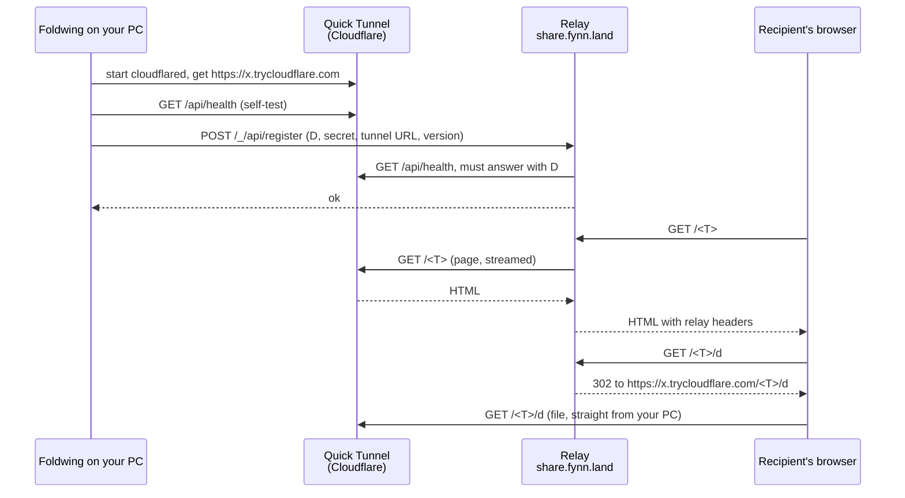

# The relay

Status: Foldwing 1.4.0. For people who want to know what happens to their links in the
default mode, and for anyone who runs a relay of their own. The worker's own setup guide (in
German) is [worker/relay/README.md](../worker/relay/README.md); the source code is the final
authority.

## What it is for

A PC at home or in an office usually can't be reached from the internet. Foldwing solves
that without an account: when something is shared, it starts a Cloudflare
[Quick Tunnel](https://developers.cloudflare.com/cloudflare-one/networks/connectors/cloudflare-tunnel/do-more-with-tunnels/trycloudflare/),
which gives the PC a random public address such as `https://<random>.trycloudflare.com`.
That address changes every time the tunnel restarts, so it can't be the link you send.

The relay at `https://share.fynn.land` is the stable part. It is a Cloudflare Worker that only
remembers which tunnel address belongs to which device. A link looks like
`https://share.fynn.land/<T>`, where `T` is 18 characters: the device ID `D` (8 characters,
created once per installation) followed by the share ID `S` (10 characters). Both are random
base62 strings.

The relay stores no files and keeps no copy of any page. Files never pass through it.

## Data flow

1. **Tunnel.** As soon as there is something to share, the app runs
   `cloudflared tunnel --no-autoupdate --config <own file> --url http://127.0.0.1:<port>` and
   reads the tunnel address from cloudflared's output. In this mode the app's server listens on
   `127.0.0.1` only, so nothing in your network can reach it directly.
2. **Self-test.** The app polls `GET <tunnel>/api/health` for up to 90 seconds, because a new
   Quick Tunnel takes a few seconds to answer.
3. **Registration.** The app sends `POST /_/api/register` with its device ID, a 32-byte secret
   (43 characters base64url), the tunnel address and its version. The relay checks the formats,
   then calls `GET <tunnel>/api/health` itself (8 seconds, no redirects) and accepts only an
   answer with `"app":"Foldwing"` and exactly this device ID. A new device is created with the
   SHA-256 hash of the secret; a known device must present the same secret.
4. **Heartbeat.** While the tunnel runs, the app registers again every 6 hours. A new tunnel
   address (after a restart) is registered right away.
5. **Visitors.** The relay looks up `D` and passes the share page and its fonts through to the
   tunnel, streamed. For the file itself (`/<T>/d`, `/<T>/<F>/d`) it answers with a redirect
   (302) to the same path on the tunnel, so the browser fetches the file directly from your PC.
   Images, video and PDFs embedded in the page take the same route.
6. **Sign-off.** A minute after the last share is gone, the app sends `POST /_/api/unregister`,
   and the relay marks the device offline. The tunnel stops.

Before the very first registration, the app shows a note about the relay with links to its
rules and privacy notice. Until you confirm it with *Okay, Link erstellen* (Okay, create
link), the app doesn't contact the relay at all.

### How the app reacts to answers

| Answer | Meaning | What the app does |
|---|---|---|
| 200 | registered | status *Online* |
| 409 `taken` | the device ID belongs to someone else's secret | creates a new device ID and secret once and tries again; all links change |
| 422 | the relay can't reach the tunnel yet | tries again after 15 seconds, at most 5 times |
| 403 `blocked` | the device is blocked | shows a note with the device ID; sharing in your own network still works |
| 429, 5xx, network error | busy or down | retries after 30 seconds, 2 minutes, then every 10 minutes |

## What is stored

The relay keeps a D1 database in Cloudflare's EU jurisdiction with two tables:

- **per device:** device ID, SHA-256 hash of the secret, current tunnel address, online yes or
  no, time of the first and the last registration, and a block with reason and date if there
  is one;
- **per blocked link:** the link ID `T`, the reason (a fixed category) and the date.

A daily job deletes devices that haven't registered for 30 days, unless they are blocked.
Blocks stay until the operator lifts them.

Not stored: files, file contents, file names, lists of shares, page contents, IP addresses of
visitors or apps, cookies. Worker logs (`observability`) are off. The app version sent at
registration is checked for its format and then dropped.

On your PC, the device ID and the secret live in the settings file. The secret is encrypted
with Electron's `safeStorage` (on Windows tied to your account). On Linux without a keyring it
is stored as base64 and marked as unencrypted.

## Security measures

The relay doesn't trust the tunnel: anyone can put their own server behind a Quick Tunnel and
register it. So:

- Registration only accepts `https://<label>.trycloudflare.com` without path or port, and only
  if the health check answers with the right device ID. The address is checked again when it is
  read from the database.
- Pages, fonts and redirects only go to fixed, checked paths of that one tunnel. The relay is
  no open proxy and no open redirect; a redirect from the tunnel is never followed (3xx
  becomes 502).
- Request headers sent on to the tunnel come from an allowlist (`Range`, `If-Range`,
  `If-None-Match`, `If-Modified-Since`, `Accept`, `Accept-Language`). No cookies, no referrer,
  no visitor IP.
- Response headers come from an allowlist (`Content-Type`, `Content-Length`, `Content-Range`,
  `Accept-Ranges`, `Content-Disposition`, `ETag`, `Last-Modified`), each format-checked. The
  relay sets its own security headers: `nosniff`, `Referrer-Policy: no-referrer`, HSTS,
  `Cache-Control` and a Content Security Policy without scripts.
- From HTML pages it removes `<meta http-equiv>`, `<link>` and `<base>`, so a foreign server
  can't use the relay as a stepping stone for phishing redirects. Anything on a page path that
  isn't HTML becomes a download, except safe inline types (images other than SVG, video, audio,
  PDF, plain text), and runs in `sandbox allow-downloads`.
- Files are served by the app's own server on the tunnel host, with its own headers (HTML and
  SVG only as attachment, sandbox). The tunnel host is a different origin from the relay, so
  even a malicious file there can't reach a relay page.
- Secrets are compared in constant time. Request bodies are limited to 2 KB, the health answer
  to 1 KB. Pages are streamed, never buffered. No CORS; errors are fixed codes without
  internals.
- Optional rate limits per device, per network and per link (Workers Rate Limiting). The
  network key is a shortened SHA-256 hash of the IP that only lives in Cloudflare's counter.

On the app side, the server answers relay paths only for its own device ID (anything else is
404), and pages fetched through a relay path link only to relay paths.

## Reports and blocks

Every page shared through the relay has *Melden* (Report) in its footer. It leads to
`/_/melden?l=<T>`, which explains what a report needs and opens a prefilled e-mail to the
operator's contact address. The operator checks the report and blocks either one link (`T`) or
a whole device (`D`) with `worker/scripts/moderate.mjs`. Visitors of a blocked link see a 451
page with the date, a fixed reason and how to object; a blocked device can't register any more
and the app says so. A block takes effect everywhere within 30 seconds.

Security problems in the relay itself are not reports of content: see
[SECURITY.md](../SECURITY.md).

## Limits

- The relay runs on Cloudflare's free plan: 100,000 worker requests a day. Every page view is a
  request, and so is every file redirect; a video that is skipped through makes many.
- Cloudflare offers Quick Tunnels without an account and without uptime guarantees. If you need
  links you can rely on, use your own domain ([cloudflare-tunnel.md](cloudflare-tunnel.md)).
- Links only work while the sharing PC is online. The relay can't serve anything on its own.

## Running your own relay

You need a Cloudflare account (the free plan is enough), a domain on it and Node.js. The
worker lives in `worker/relay/`; its [README](../worker/relay/README.md) has every step. In
short:

1. `npx wrangler d1 create foldwing-relay --jurisdiction eu`
2. Copy `wrangler.example.toml` to `wrangler.toml` (git ignores it) and fill in the database
   ID, your host name and the operator variables: `CONTACT_EMAIL`, `IMPRINT_URL`,
   `PRIVACY_URL`, `TERMS_URL`, optionally `SOURCE_URL`.
3. `npx wrangler d1 execute foldwing-relay --remote --file schema.sql`
4. `npx wrangler deploy`

Then point the app at it: set `DEFAULT_RELAY_URL` in `src/main/relay.ts` to your address and
build Foldwing. The app's links to the relay's info page, rules, privacy notice and imprint
(`/_/`, `/_/regeln`, `/_/datenschutz`, `/_/impressum`) then lead to your pages. For tests and
development only, the environment variable `FOLDWING_RELAY_URL` overrides the address
without a rebuild.

As an operator you are the contact for reports about links on your relay. Check the legal
requirements where you live before you run one publicly.

The worker is tested in `tests/relay-worker.test.ts` and the app side in
`tests/relay.test.ts`; both run with `npm test` against mocks. Type check:
`npx tsc --noEmit -p worker/relay`.
